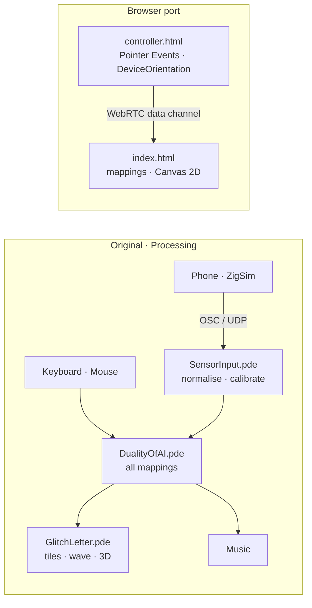

# Kinetic Typography

A letterform driven in real time by a smartphone's sensors. Touch and compass data stream from the phone to a Processing sketch over OSC, where the letter is sliced into tiles, distorted with a sine wave, rotated in 3D and paired with a generative soundtrack. A browser port does the same over WebRTC: scan a QR code and your phone becomes the controller.

**[Live demo](https://YOUR-USERNAME.github.io/kinetic-typography/)** · **[Case study](https://YOUR-PORTFOLIO/projects/kinetic-typography/)**

<!-- TODO: record a short screen capture and save it as media/demo.gif -->


## About

Made for **Techniques et savoir-faire**, part of the Digital Media Design programme at L'École de Design, mentored by [Mickael Lafontaine](https://vimeo.com/mickaellafontaine).

| Person | Role |
| --- | --- |
| Aman Pathak | Sensor pipeline: phone data over OSC, normalisation and calibration so it fully drives the graphic. Later: debugging, refactor and the browser port. |
| Olli Rova | The graphic: tiling, sine distortion and 3D rendering |
| Claudio Lintunen | Course deliverables: storyboard and user manual |

The concept was ideated by all three equally.

## How it works



Every input is normalised before it reaches the mapping layer, so each mapping works on the same scale and can be changed in one place.

### Signal mapping

| Input | Normalised to | Drives |
| --- | --- | --- |
| Finger 1 position | x, y ∈ [0, 1] | Tile count (x), wave amplitude (y) |
| Finger 2 position | x ∈ [0, 1] | 3D rotation |
| Compass heading | θ ∈ [0, 360) | Music and wave speed |
| Letter keys | A–Z | The rendered letter |
| Space bar | — | Compass calibration (current heading becomes 0°) |
| Mouse | x, y ∈ [0, 1] | Stands in for touch when no phone is connected |

## Repository structure

```
kinetic-typography/
├── processing/DualityOfAI/   Processing sketch (original installation)
├── web/                      Browser port, deployed to GitHub Pages
│   ├── index.html            Live demo with QR pairing
│   └── controller.html       Phone controller
├── deliverables/             Storyboard and user manual
├── media/                    Demo GIF and screenshots
└── .github/workflows/        GitHub Pages deployment
```

## Running the Processing version

**You need:** [Processing 4](https://processing.org/download), the **oscP5** library, the [ZigSim](https://1-10.github.io/zigsim/) app on your phone, and the phone and computer on the same Wi-Fi network.

1. In Processing, open **Sketch → Import Library → Manage Libraries**, search for **oscP5** and install it.
2. Open `processing/DualityOfAI/DualityOfAI.pde`.
3. In ZigSim, set the protocol to **UDP** and the message format to **OSC**. Set the IP address to your computer's local IP and the port to the one in `SensorInput.pde`. Enable **Touch** and **Compass**.
4. Run the sketch, then start sending from ZigSim.

**Controls:** touch to fracture and rotate the letter, turn around to change the wave speed, type a letter to swap it, press **space** to calibrate the compass. The mouse stands in for touch when no phone is connected.

**If touch doesn't respond:** set `debug = true` in `SensorInput.pde` to print incoming OSC addresses. The sketch expects `touch01`/`touch02` for finger 1 and `touch11`/`touch12` for finger 2.

## Running the browser version

The browser port needs no build step and no server code. Pairing uses [PeerJS](https://peerjs.com/): its public server only introduces the two devices, then data flows directly between them.

**Locally:** run `python3 -m http.server` inside `web/` and open `http://localhost:8000`. The sliders and mouse work. Pairing a real phone needs HTTPS, so use the deployed version for that.

**Deploy to GitHub Pages:** in the repository, open **Settings → Pages** and set **Source** to **GitHub Actions**. Every push to `main` then publishes `web/` automatically.

**Notes:** iPhones ask permission to use motion sensors when you tap Connect. Some strict networks (office or university Wi-Fi) block direct WebRTC connections; the page then falls back to its sliders.

## Engineering notes

The original course build didn't reliably show the phone controlling the piece. Tracing the path from sensor to screen found six faults:

| Fault | Effect | Fix |
| --- | --- | --- |
| `setupSmartphone()` never called | No OSC data arrived | Called from `setup()` |
| OSC thread and `draw()` shared state unsynchronised | Inconsistent frames | Synchronized access in `SensorInput` |
| Compass offset of 577 | Headings above 360° | Calibration on space, wrapped to [0, 360) |
| Every OSC message printed | Frame rate dropped | A single `debug` flag |
| `createFont()` before `size()` | Unreliable font setup | Initialisation reordered |
| Letter and grid hard-coded | Nothing changed at runtime | Keyboard selection, touch-driven grid |

The fix split one sketch into three modules: input (`SensorInput`), mapping (`DualityOfAI`) and rendering (`GlitchLetter`).

## License

<!-- TODO: agree a license with Olli and Claudio before choosing one -->
TODO
